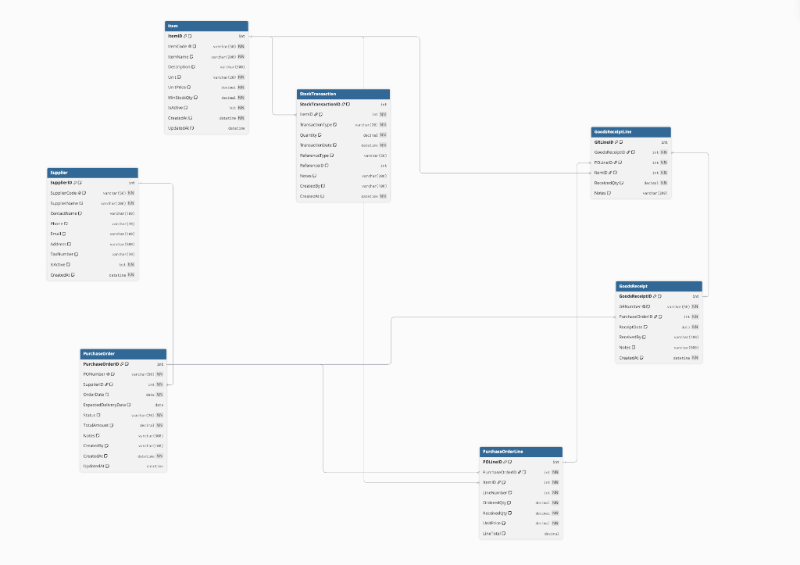

# ERP Geliştirme ve Destek Uzmanı Teknik Değerlendirme Çalışması

**Hazırlayan:** Gülşah Demir  
**Tarih:** Ekim 2026  
**Konu:** Satınalma ve Stok Yönetimi Modülü Tasarımı, SQL Analizleri, API Mimarisi ve Destek Senaryosu Analizi  

---

## 📑 Çalışma Başlıkları
1. [Bölüm 1: Veri Modeli Tasarımı](#bölüm-1-veri-modeli-tasarımı)
2. [Bölüm 2: SQL Çalışması](#bölüm-2-sql-çalışması)
3. [Bölüm 3: REST API Tasarımı](#bölüm-3-rest-api-tasarımı)
4. [Bölüm 4: ERP Destek Senaryosu (100 Sipariş / 60 Teslimat Vakası)](#bölüm-4-erp-destek-senaryosu)
5. [Bölüm 5: Yetkilendirme ve Güvenlik](#bölüm-5-yetkilendirme-ve-güvenlik)
6. [Bonus Bölüm: ERP Yönetim Dashboard Uygulaması](#bonus-bölüm-erp-yönetim-dashboard-uygulaması)

---

## Bölüm 1: Veri Modeli Tasarımı

Sistemde satınalma ve stok akışını yönetecek 7 temel tablo ilişkisel modelde tasarlanmıştır:
* **Item:** Ürün ana kartları, birim, birim fiyat ve kritik stok eşiği.
* **Supplier:** Tedarikçi firma bilgileri.
* **PurchaseOrder & PurchaseOrderLine:** Header-Line yapısında satınalma siparişleri.
* **GoodsReceipt & GoodsReceiptLine:** Kısmi teslimatları destekleyen mal kabul kayıtları.
* **StockTransaction:** Giriş (`IN`) ve çıkış (`OUT`) hareketlerini saklayan, denetim izi sağlayan stok defteri.

### ER Diyagramı

* SQL Tablo Scripti: [`bolum1_veri_modeli.sql`](bolum1_veri_modeli.sql)
* dbdiagram.io Kodu: [`bolum1_dbdiagram.dbml`](bolum1_dbdiagram.dbml)

---

## Bölüm 2: SQL Çalışması

Talep edilen senaryolar için hazırlanan optimize sorgular:
1. **Güncel Stok Miktarı:** `StockTransaction` tablosunda `SUM(CASE WHEN TransactionType = 'IN' THEN Quantity ELSE -Quantity END)` ile anlık net bakiye hesabı.
2. **Son 30 Günün En Çok Alınan İlk 10 Ürünü:** Sipariş kalemleri ve tarih filtresi ile miktar bazlı sıralama.
3. **Eksik Teslim Edilen Siparişler:** Sipariş miktarı teslim alınandan büyük olan açık siparişlerin tespiti.
4. **Son 90 Gün Hareketsiz Ürünler:** `NOT EXISTS` ile ölü stok analizi.

* SQL Sorgu Dosyası: [`bolum2_sql_sorgulari.sql`](bolum2_sql_sorgulari.sql)

---

## Bölüm 3: REST API Tasarımı

Ürün kartı, satınalma siparişi, mal kabul ve stok takibi için RESTful servisler kurgulanmıştır. Özellikle kısmi mal kabul senaryolarında siparişin `PartiallyReceived` olarak açık tutulması ve uygun HTTP durum kodları (`200`, `201`, `400`, `404`, `409`) dokümante edilmiştir.

* Detaylı API Dokümanı: [`bolum3_api_tasarim.md`](bolum3_api_tasarim.md)

---

## Bölüm 4: ERP Destek Senaryosu
**Problem:** *"100 adetlik satınalma siparişi oluşturduk. Ürün teslim alındı ancak stok ekranında yalnızca 60 adet görünüyor."*

Bu vaka kıdemli bir ERP destek yaklaşımıyla ele alınmıştır:
* **Olası Nedenler:** Kısmi teslimat, depocunun manuel giriş hatası, hasarlı ürün reddi, hızlı üretim çıkışı ve entegrasyon gecikmesi.
* **Kontrol Noktaları:** Sipariş detay ekranı, mal kabul fişi ve ürün stok ekstresi.
* **Veritabanı Analizi:** Sipariş satırı, mal kabul satırı ve stok hareketleri çapraz sorgulanarak teşhis edilmiştir.
* **Kök Neden Çözümü:** 5 Neden (5 Whys) analizi ile problemin tekrarlanmaması için barkod/el terminali entegrasyonu ve arayüz doğrulama kontrolleri (CAPA) önerilmiştir.

* Vaka Çözüm Dokümanı: [`bolum4_erp_destek.md`](bolum4_erp_destek.md)

---

## Bölüm 5: Yetkilendirme ve Güvenlik
* **Rol Yetki Matrisi:** Satınalma Uzmanı, Depo Personeli, Üretim Planlama ve Sistem Yöneticisi için CRUD yetkileri belirlenmiştir.
* **Görevler Ayrılığı (SoD):** Siparişi oluşturan kullanıcının mal kabul yapması engellenmiş, depo personelinin birim satınalma fiyatlarını görmesi maskelenmiştir.
* **RBAC & Veri Güvenliği:** JWT tabanlı rol yönetimi, stok hareketlerinde fiziksel silmenin yasaklanması (yalnızca ters kayıt) ve SQL Injection koruma prensipleri uygulanmıştır.

* Güvenlik Dokümanı: [`bolum5_guvenlik_yetkilendirme.md`](bolum5_guvenlik_yetkilendirme.md)

---

## Bonus Bölüm: ERP Yönetim Dashboard Uygulaması

Yapay bir şablon yerine; **staj sürecimde caniasERP ile entegre olarak geliştirdiğimiz "Satınalma ve Tedarikçi Portalı"** yönetim arayüzü sunulmuştur:

* **Sipariş Hacmi & Trend:** Son 12 aylık sipariş bütçesi (TL/EUR) ve aylık sipariş eğilimleri.
* **Tedarikçi Dağılımı:** En yüksek alım yapılan ilk 5 tedarikçi listesi ve sipariş tutarları.
* **Açık Sipariş ve Gecikme Takibi:** Teslim tarihi geçen ve işlem bekleyen açık siparişlerin anlık durumu.
* **Termin Performansı:** Tedarikçilerin zamanında teslimat oranları.

* Dashboard Detay Dokümanı: [`bonus_dashboard_tasarim.md`](bonus_dashboard_tasarim.md)
