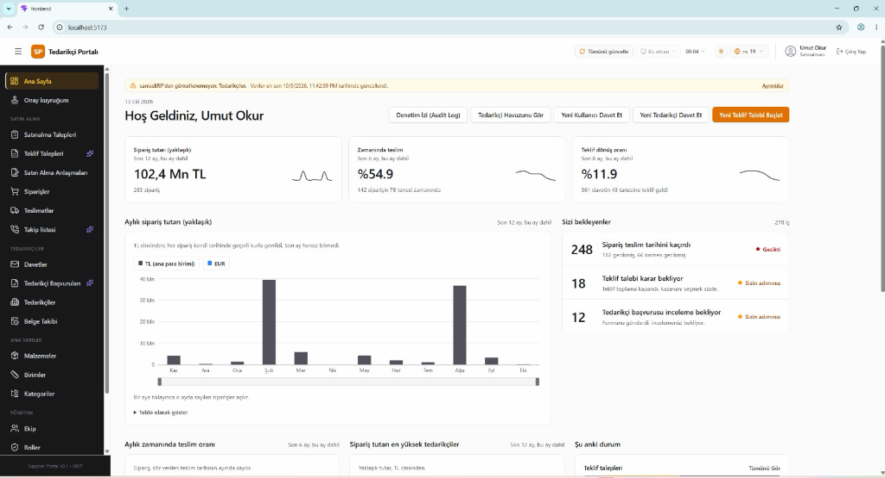
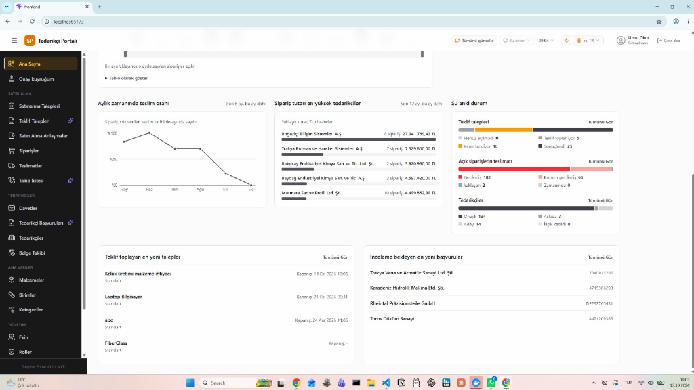

# Bonus Bölüm: ERP Yönetim Paneli (Dashboard) Tasarımı

## 1. Genel Yaklaşım ve Proje Referansı
Ödevde talep edilen ERP Yönetim Dashboard'u için yapay bir taslak yerine; **staj sürecimde bizzat üzerinde çalıştığım ve üretim ERP sistemi (caniasERP) ile entegre çalışan gerçek "SP Satınalma ve Tedarikçi Portalı"** arayüzü ve mimarisi referans alınmıştır.

Panel; satınalma uzmanları ve fabrika yöneticilerinin açık siparişleri, tedarikçi hacimlerini ve teslimat performanslarını canlı olarak izleyebileceği bir karar destek sistemi olarak kurgulanmıştır.

---

## 2. Gerçek Sistem Arayüzü (Dashboard Ekranları)

### Ekran 1: Özet KPI'lar, Aylık Sipariş Trendi ve Bekleyen Görevler
Aşağıdaki ekranda son 12 aylık toplam sipariş hacmi (102,4 Mn TL), zamanında teslim oranı (%54.9), aylık sipariş trend grafiği ve operasyonel aksiyon bekleyen siparişler yer almaktadır:

### Ekran 2: Tedarikçi Dağılımı, Açık Sipariş Durumları ve Teslimat Trendi
Bu bölümde en çok alım yapılan tedarikçiler (Boğaziçi Bilişim, Trakya Rulman, Bakırçay vb.), açık siparişlerin gecikme analizi ve aylık zamanında teslim grafiği sunulmaktadır:

---

## 3. Ödev KPI'larının Sistemdeki Karşılığı

| Ödevde İstenen KPI | Portalımızdaki Karşılığı | İş Mantığı & Değeri |
|---|---|---|
| **En çok alım yapılan tedarikçiler** | *Sipariş Tutarı En Yüksek Tedarikçiler* | Şirket bütçesinin en çok aktığı ilk 5 firma listelenir. Hacim bazlı iskonto pazarlıklarında doğrudan kullanılır. |
| **Son 12 aylık satınalma trendi** | *Aylık Sipariş Tutarı Grafiği* | Para birimi bazında (TL/EUR) aylık harcama eğilimi incelenir, dönemsel bütçe planlaması yapılır. |
| **Açık satınalma siparişleri** | *Açık Siparişlerin Teslimatı & Sizi Bekleyenler* | Teslim tarihi geçen (gecikmiş) ve kısmi teslimat bekleyen açık siparişler anlık uyarı olarak listelenir. |
| **Zamanında teslimat oranı** | *Zamanında Teslim % & Aylık Trend* | Tedarikçilerin termin sürelerine uyum performansı ölçülür. |

---

## 4. Kullanılan Mimari ve Entegrasyon
* **Frontend:** Modern Web Arayüzü (Vite / React / Tailwind)
* **ERP Entegrasyonu:** caniasERP servisleri ve arka plan REST API entegrasyonu
* **Veri Güncelliği:** Ekran başında son güncelleme zamanı ve audit log (denetim izi) takibi
